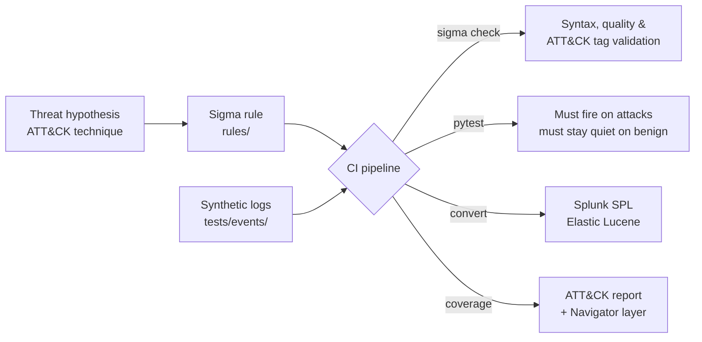

# detection-rules-lab

[](https://github.com/Emmanueltankam/detection-rules-lab/actions/workflows/ci.yml)


[](LICENSE)

**Detection-as-code lab**: Sigma rules mapped to MITRE ATT&CK, **tested against synthetic attack and benign logs on every commit**, and automatically converted into Splunk and Elastic queries.

The idea is simple: a detection rule is code, so it deserves the same discipline as code — review, tests, CI and versioning. A rule that has never been proven to fire on the attack it targets is only a hypothesis.

---

## How it works



| Step | What happens | Tooling |
|---|---|---|
| **Validate** | Syntax, metadata, filename conventions, valid ATT&CK tags | `sigma check` (pySigma validators) |
| **Test** | Each rule is compiled to SQL and run against its own **true-positive** and **true-negative** samples in an in-memory database | `pytest` + pySigma SQLite backend ([`tools/sigma_engine.py`](tools/sigma_engine.py)) |
| **Convert** | Every rule becomes a ready-to-paste SIEM query, published as a CI artifact | `sigma convert` → Splunk, Elastic ([`tools/convert.sh`](tools/convert.sh)) |
| **Report** | Coverage table and ATT&CK Navigator layer regenerated from the rules, CI fails if out of date | [`tools/build_coverage.py`](tools/build_coverage.py) |
| **Secrets** | Full-history secret scanning on every push | Gitleaks |

---

## Detection coverage

**10 rules · 11 techniques · 8 tactics** — full table in [`docs/COVERAGE.md`](docs/COVERAGE.md).

| Rule | Platform | ATT&CK | Level |
|---|---|---|---|
| [PowerShell Execution With Encoded Command](rules/windows/process_creation/proc_creation_win_powershell_encoded_command.yml) | Windows | T1059.001, T1027 | medium |
| [Shadow Copy or Backup Catalog Deletion](rules/windows/process_creation/proc_creation_win_shadow_copy_deletion.yml) | Windows | T1490 | high |
| [LSASS Memory Dump Via Comsvcs.dll](rules/windows/process_creation/proc_creation_win_rundll32_comsvcs_lsass_dump.yml) | Windows | T1003.001 | high |
| [Scheduled Task Created From a User-Writable Path](rules/windows/process_creation/proc_creation_win_schtasks_create_suspicious_path.yml) | Windows | T1053.005 | medium |
| [Windows Security Event Log Cleared](rules/windows/builtin/security/win_security_event_log_cleared.yml) | Windows | T1685.005 | high |
| [Account Added To a Highly Privileged Group](rules/windows/builtin/security/win_security_member_added_to_privileged_group.yml) | Windows / AD | T1098 | high |
| [Linux Reverse Shell Command Patterns](rules/linux/process_creation/proc_creation_lnx_reverse_shell_patterns.yml) | Linux | T1059.004 | high |
| [Linux User Added To sudo Or wheel Group](rules/linux/process_creation/proc_creation_lnx_user_added_to_sudo_group.yml) | Linux | T1098 | medium |
| [Linux Shell History Tampering](rules/linux/process_creation/proc_creation_lnx_clear_shell_history.yml) | Linux | T1070.003, T1690 | high |
| [SQL Injection Patterns In URI Query](rules/web/webserver/web_sqli_patterns_in_uri_query.yml) | Web / API | T1190 | high |

Tags follow **ATT&CK v19**, including the split of *Defense Evasion* into **Stealth** and **Defense Impairment** (e.g. clearing Windows event logs is now T1685.005).

To view the coverage on the matrix, open [`docs/attack-navigator-layer.json`](docs/attack-navigator-layer.json) in the [ATT&CK Navigator](https://mitre-attack.github.io/attack-navigator/).

---

## Quick start

```bash
git clone https://github.com/Emmanueltankam/detection-rules-lab.git
cd detection-rules-lab
python -m venv .venv && source .venv/bin/activate
make install   # pySigma, sigma-cli, backends, pytest

make check     # validate all rules
make test      # run the detection tests
make convert   # generate dist/splunk/*.spl and dist/elastic/*.lucene
```

Example — the privileged-group rule converted for Splunk:

```spl
source="WinEventLog:Security" (EventCode=4732 TargetSid="S-1-5-32-544")
  OR (EventCode=4728 TargetSid="*-512")
  OR (EventCode=4756 TargetSid IN ("*-518", "*-519"))
```

---

## Adding a rule

1. Write the rule in `rules/<platform>/...` following the naming convention (`proc_creation_win_*`, `proc_creation_lnx_*`, `win_security_*`, `web_*`).
2. Add `tests/events/<same-file-name>.yml` with at least one `match` event (the attack) and one `no_match` event (the closest benign look-alike).
3. Run `make test` — the rule must catch every attack sample and ignore every benign one.
4. Run `make coverage` to refresh the ATT&CK report, then open a pull request.

The reasoning behind each step (hypothesis, telemetry, tuning, triage) is described in [`docs/METHODOLOGY.md`](docs/METHODOLOGY.md).

---

## Repository layout

```text
rules/                 Sigma rules, organised by platform and log source
tests/events/          Synthetic true-positive / true-negative events, one file per rule
tests/test_rules.py    Quality gate: detection tests + metadata + conventions
tools/sigma_engine.py  Offline engine: Sigma → SQL → in-memory SQLite
tools/convert.sh       Bulk conversion to Splunk and Elastic
tools/build_coverage.py  ATT&CK coverage report + Navigator layer
docs/                  Coverage report, Navigator layer, methodology
```

---

## Disclaimer

All test data is **synthetic** and written for this lab: no real hosts, users or company data (see [`SECURITY.md`](SECURITY.md)). Rules are a starting point — tune them to your environment's baseline before production use.

**Author:** Emmanuel Tankam Talla — Blue Team / SOC & detection engineering. Licensed under MIT.
